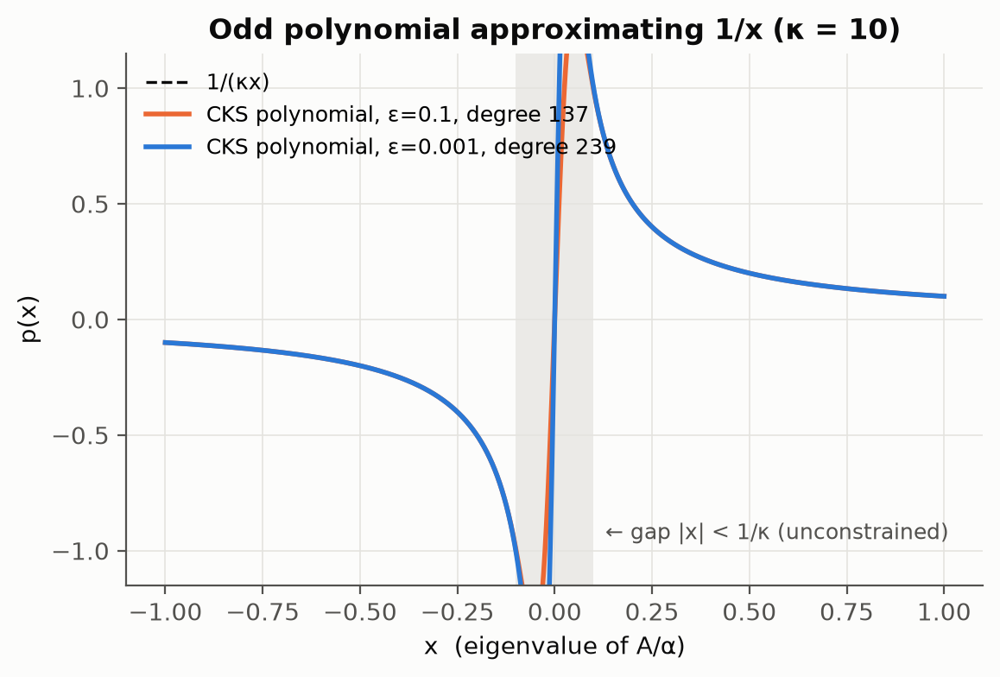
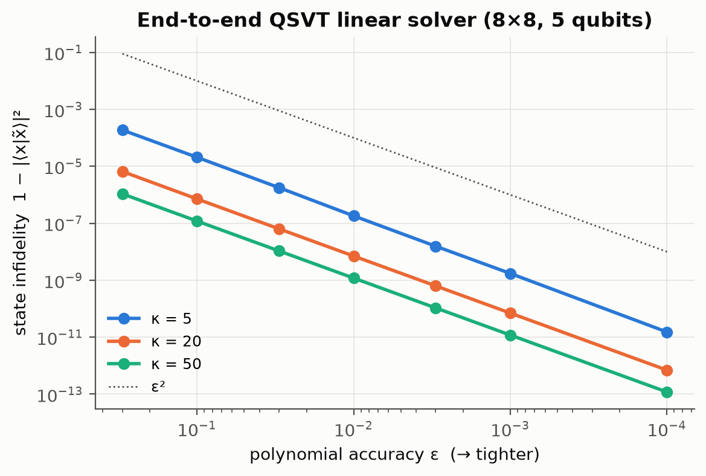
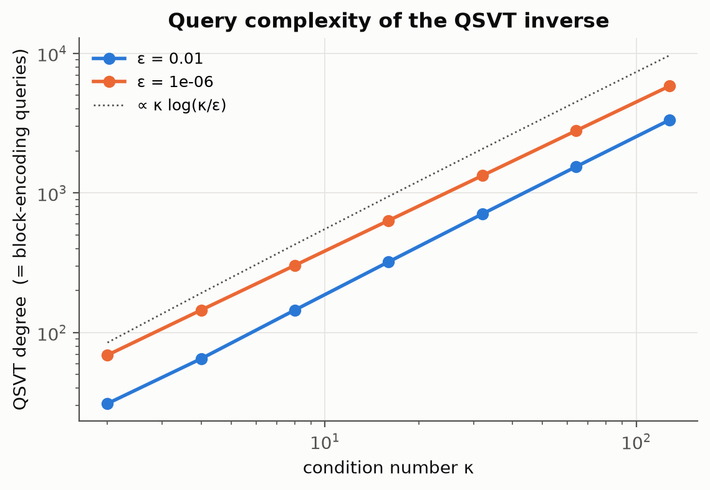

# qsvtlab: Quantum Singular Value Transformation in PennyLane

A small, tested library that runs the **quantum singular value transformation (QSVT)** end
to end in [PennyLane](https://pennylane.ai). It finds QSVT phases at high polynomial degree,
builds the circuits, and verifies them. Two QSVT applications are built on top:

* **A quantum linear-system solver.** It prepares $|x\rangle \propto A^{-1}|b\rangle$, runs as
  a PennyLane circuit, and is checked against `numpy.linalg.solve`.
* **Hamiltonian simulation.** It implements $e^{-iHt}$ with Jacobi–Anger polynomials and
  compares gate counts with 1st-, 2nd- and 4th-order Trotterization.

Everything is verified against exact linear algebra (16 tests). Every figure below is
reproduced by `python benchmarks/run_benchmarks.py` in about 80 s on a laptop.

## Highlights

| | |
|---|---|
| **High-degree QSP phases** | A Chebyshev-basis fixed-point and Newton solver finds the phases for a **degree-1731** polynomial in **0.33 s**, with an error around 1e-10. On the same 1/x targets, `qml.poly_to_angles` fails (root-finding) or **silently returns wrong phases** (iterative, error 0.03 at degree 63). |
| **Exact real-part QSVT** | A single LCU ancilla removes the "imaginary junk" polynomial. The post-selected block equals $f(A)$ to $10^{-13}$, for both parities and for complex Hermitian $A$. |
| **Linear solver** | For $\kappa = 50$ (QSVT degree 1661) the state fidelity is **1 − 1.2×10⁻¹³**. $\lVert A^{-1}b\rVert$ is recovered from the success probability to 2×10⁻⁶. Non-Hermitian $A$ is handled through the Hermitian embedding. |
| **QSVT vs Trotter** | QSVT error falls super-exponentially with CNOT count. On a 4-qubit TFIM ($t=2$) it overtakes 4th-order Trotter below about $10^{-9}$ error. |
| **Two PennyLane pitfalls documented** | `qml.BlockEncode` rescales by an ∞-norm bound rather than the spectral norm, and `qml.TrotterProduct(H, t)` approximates $e^{+iHt}$. Both are covered by tests. |

## Results

### 1. Phase finding at scale


QSVT needs one phase per polynomial degree. Useful applications need degrees in the
hundreds to thousands: matrix inversion scales as $O(\kappa\log(\kappa/\epsilon))$.
PennyLane's `poly_to_angles` takes the polynomial in the monomial basis, which is
exponentially ill-conditioned. `qsvtlab.solve_qsp_phases` stays in the Chebyshev basis and
uses the fixed-point iteration of Dong, Lin, Ni & Wang
([arXiv:2209.10162](https://arxiv.org/abs/2209.10162)), with a Newton fallback. Each
iteration is a vectorized $O(d^2)$ sweep over Chebyshev nodes.

### 2. An end-to-end quantum linear solver



The inverse is the odd polynomial of Childs, Kothari & Somma: an approximation to
$(1-(1-x^2)^b)/x$ with provable error $\epsilon$ on $[1/\kappa, 1]$, whose Chebyshev
coefficients are evaluated stably as binomial tail probabilities. The circuit is
`StatePrep(b) → QSVT → post-select`, and it runs on `default.qubit`.



| κ | ε | QSVT degree | fidelity | success prob. | ‖x‖ rel. error |
|---|---|---|---|---|---|
| 5  | 1e-2 | 85   | 0.99999982 | 1.4e-2 | 1.1e-4 |
| 5  | 1e-4 | 135  | 1 − 1.5e-11 | 7.9e-3 | 1.0e-6 |
| 20 | 1e-2 | 415  | 0.9999999929 | 4.8e-2 | 4.8e-4 |
| 20 | 1e-4 | 613  | 1 − 7e-13 | 3.0e-2 | 4.8e-6 |
| 50 | 1e-2 | 1167 | 0.9999999988 | 1.6e-2 | 1.9e-4 |
| 50 | 1e-4 | 1661 | 1 − 1.2e-13 | 1.0e-2 | 1.9e-6 |



### 3. Hamiltonian simulation: QSVT vs Trotter


The QSVT circuit is $\cos(Ht)$ and $\sin(Ht)$, combined by LCU over a `PrepSelPrep` block
encoding with $\lambda = 5.8$. The full post-selected unitary is computed in PennyLane and
compared with `scipy.linalg.expm`. CNOT counts come from PennyLane's own decomposition into
{CNOT, single-qubit gates}.

**Honest takeaway.** For a small system at moderate precision, Trotter wins clearly. One
QSVT query (a `PrepSelPrep` over 7 Pauli terms) costs about 196 CNOTs; one Trotter step
costs about 12. QSVT's error, however, decays like $(e\tau/2R)^R$, so it overtakes 4th-order
Trotter at around $10^{-9}$. The crossover moves to looser precisions for longer times and
for Hamiltonians with many non-commuting terms. A natural next step is to measure that shift
(see *Next steps*).

## Quick start

```bash
git clone <this repo> && cd qsvtlab
python -m venv .venv && source .venv/bin/activate
pip install -e ".[dev]"
pytest -q                                   # 16 tests, about 2 s
python benchmarks/run_benchmarks.py         # regenerates figures/ and benchmarks/results.json
jupyter notebook notebooks/qsvt_tour.ipynb  # guided tour
```

```python
import numpy as np, qsvtlab as ql

A = np.random.randn(4, 4); b = np.random.randn(4)
r = ql.qsvt_solve(A, b, eps=1e-3)
print(r.fidelity, r.degree, r.success_prob)     # ~1.0, QSVT degree, post-selection prob.

H = ql.tfim(3)
s = ql.qsvt_time_evolution(H, t=1.0, eps=1e-8)
print(s.error)                                   # ||U - e^{-iHt}|| ~ 1e-9
```

## Layout

```
qsvtlab/
  angles.py           Chebyshev-native QSP phase solver (FPI + Newton), W_x -> reflection conversion
  polynomials.py      CKS inverse, least-squares inverse, Jacobi–Anger cos/sin
  block_encodings.py  exact unitary dilation + PrepSelPrep LCU encoding with explicit alpha
  circuits.py         real-part QSVT circuit (one extra ancilla), block extraction for verification
  linear_solver.py    qsvt_solve(): end-to-end linear-system solver
  hamiltonian_sim.py  QSVT e^{-iHt}, Trotter baselines, CNOT cost models
tests/                16 tests checking every component against exact linear algebra
benchmarks/           reproduces all figures and results.json
notebooks/            qsvt_tour.ipynb: a guided walkthrough
```

## How the conventions fit together

1. **W_x QSP.** Symmetric phases $\Phi$ give $f(x) = \mathrm{Im}\langle 0|U_\Phi(x)|0\rangle$.
2. **Reflection QSVT.** Because $W(x) = i\,e^{-i\pi Z/4} R(x) e^{-i\pi Z/4}$, the phases
   shift by $-\pi/2$ (and $-\pi/4$ at the ends). The global factor $i^d$, and the extra
   $-i$ that turns Im into Re, are absorbed into $\varphi_0$, using
   $\Pi e^{i\delta(2\Pi - 1)} = e^{i\delta}\Pi$.
3. **Real part.** Negating every phase conjugates the polynomial's coefficients, so
   $\tfrac12(U_{\vec\varphi} + U_{-\vec\varphi})$, implemented with one ancilla, yields
   exactly $f(A)$.

Each step is checked numerically in `tests/test_qsvtlab.py`.

## Next steps

* **Amplitude amplification:** replace post-selection with fixed-point or oblivious
  amplitude amplification, itself a QSVT, so success probability rises from $O(1/\kappa^2)$
  toward 1.
* **Crossover map:** measure the QSVT-vs-Trotter crossover as a function of $t$, system
  size, and Hamiltonian family (TFIM, Heisenberg, molecular Hamiltonians from `qml.qchem`).
* **Cheaper block encodings:** use THC or double-factorized encodings for chemistry, and
  qubitization to save the real-part ancilla.
* **Upstream:** contribute a Chebyshev-input mode to `qml.poly_to_angles`, and a warning when
  the iterative solver returns a high-error result.

## References

* Gilyén, Su, Low & Wiebe, *Quantum singular value transformation and beyond*, STOC 2019, [arXiv:1806.01838](https://arxiv.org/abs/1806.01838)
* Martyn, Rossi, Tan & Chuang, *A grand unification of quantum algorithms*, PRX Quantum 2021, [arXiv:2105.02859](https://arxiv.org/abs/2105.02859)
* Dong, Lin, Ni & Wang, *Infinite quantum signal processing*, [arXiv:2209.10162](https://arxiv.org/abs/2209.10162)
* Childs, Kothari & Somma, *Quantum algorithm for systems of linear equations with exponentially improved dependence on precision*, SIAM J. Comput. 2017
* Low & Chuang, *Hamiltonian simulation by qubitization*, Quantum 2019
