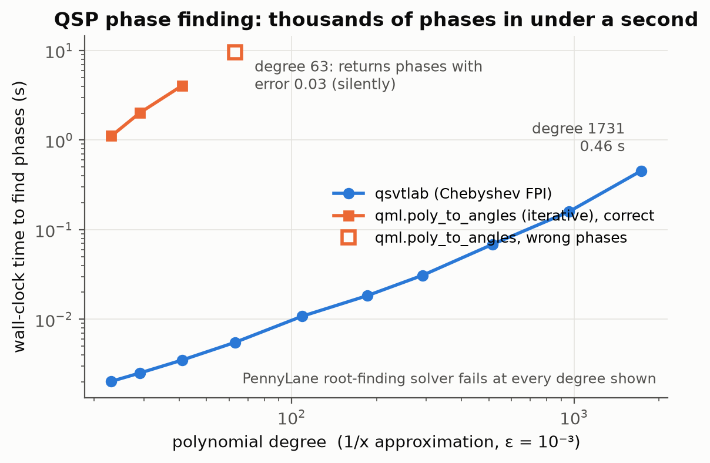
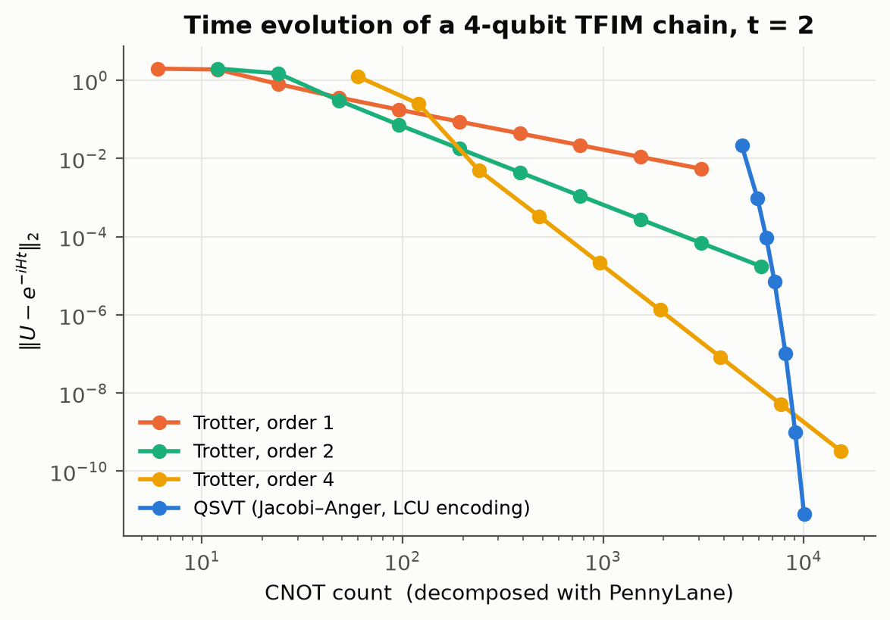
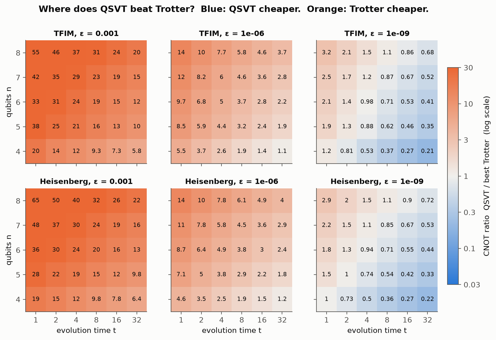
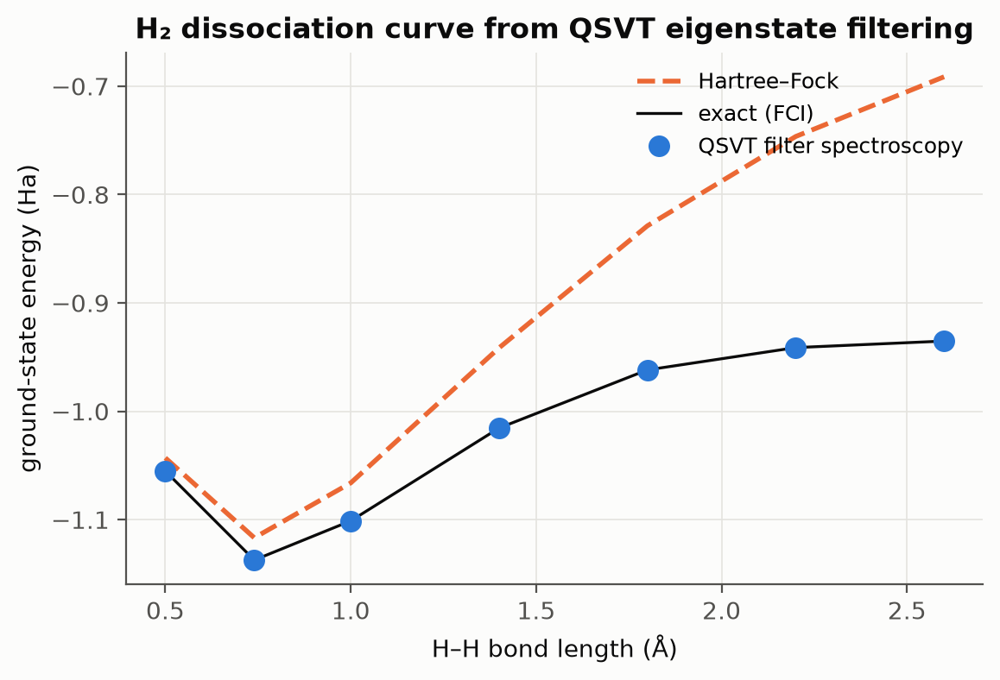
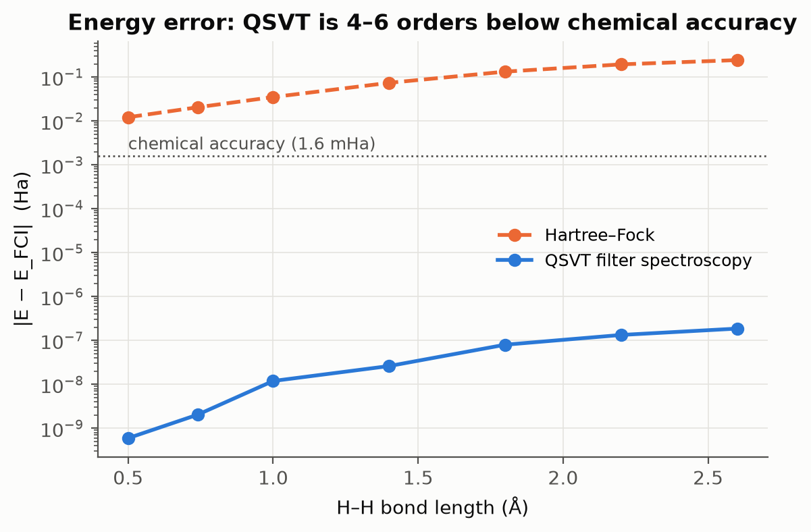
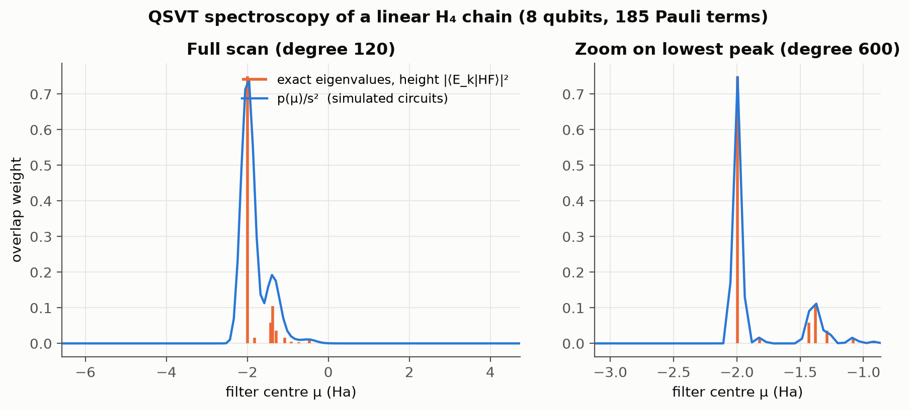
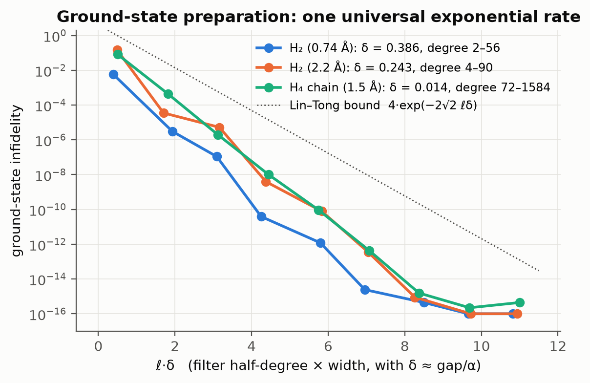

# qsvtlab: Quantum Singular Value Transformation in PennyLane

A small, tested library that runs the **quantum singular value transformation (QSVT)** end
to end in [PennyLane](https://pennylane.ai). It finds QSVT phases at high polynomial degree,
builds the circuits, and verifies them. Three QSVT applications are built on top:

* **A quantum linear-system solver.** It prepares $|x\rangle \propto A^{-1}|b\rangle$, runs as
  a PennyLane circuit, and is checked against `numpy.linalg.solve`.
* **Hamiltonian simulation.** It implements $e^{-iHt}$ with Jacobi–Anger polynomials and
  compares gate counts with Trotterization, mapping **where** each method wins across
  system size, simulation time and precision.
* **Quantum chemistry.** It estimates ground-state energies and prepares ground states of
  molecules (H₂ and an H₄ chain from `qml.qchem`) by QSVT eigenstate filtering, starting
  from Hartree–Fock with no prior knowledge of the energy.

Everything is verified against exact linear algebra (21 tests). Every figure
below is reproduced by `python benchmarks/run_benchmarks.py` in about 10 minutes on a laptop.

## Highlights

| | |
|---|---|
| **High-degree QSP phases** | A Chebyshev-basis fixed-point and Newton solver finds the phases for a **degree-1731** polynomial in **under 0.5 s**, with an error around 1e-10. On the same 1/x targets, `qml.poly_to_angles` fails (root-finding) or **silently returns wrong phases** (iterative, error 0.03 at degree 63). |
| **Exact real-part QSVT** | A single LCU ancilla removes the "imaginary junk" polynomial. The post-selected block equals $f(A)$ to $10^{-13}$, for both parities and for complex Hermitian $A$. |
| **Linear solver** | For $\kappa = 50$ (QSVT degree 1661) the state fidelity is **1 − 1.2×10⁻¹³**. $\lVert A^{-1}b\rVert$ is recovered from the success probability to 2×10⁻⁶. Non-Hermitian $A$ is handled through the Hermitian embedding. |
| **Chemistry** | Filter spectroscopy finds the H₂ ground-state energy along the whole dissociation curve to within **6×10⁻¹⁰–2×10⁻⁷ Ha**, 4–6 orders below chemical accuracy, even where Hartree–Fock overlap drops to 58%. For an 8-qubit H₄ chain the error is 3.0×10⁻⁷ Ha. |
| **QSVT vs Trotter crossover map** | Over 180 (model, n, t, ε) settings, CNOT counts come from PennyLane's own decompositions. Trotter wins by 6–65× at ε = 10⁻³. QSVT wins (down to 0.21×) only at ε ≈ 10⁻⁹ with long times, and its advantage *shrinks* with system size because the `PrepSelPrep` cost per query grows faster than the number of terms. |
| **Two PennyLane pitfalls documented** | `qml.BlockEncode` rescales by an ∞-norm bound rather than the spectral norm, and `qml.TrotterProduct(H, t)` approximates $e^{+iHt}$. Both are covered by tests. |

## Results

### 1. Phase finding at scale



QSVT needs one phase per polynomial degree. Useful applications need degrees in the
hundreds to thousands: matrix inversion scales as $O(\kappa\log(\kappa/\epsilon))$.
PennyLane's `poly_to_angles` takes the polynomial in the monomial basis, which is
exponentially ill-conditioned. `qsvtlab.solve_qsp_phases` stays in the Chebyshev basis and
uses the fixed-point iteration of Dong, Lin, Ni & Wang
([arXiv:2209.10162](https://arxiv.org/abs/2209.10162)), with a Newton fallback. Each
iteration is a vectorized $O(d^2)$ sweep over Chebyshev nodes.

### 2. An end-to-end quantum linear solver


The inverse is the odd polynomial of Childs, Kothari & Somma: an approximation to
$(1-(1-x^2)^b)/x$ with provable error $\epsilon$ on $[1/\kappa, 1]$, whose Chebyshev
coefficients are evaluated stably as binomial tail probabilities. The circuit is
`StatePrep(b) → QSVT → post-select`, and it runs on `default.qubit`.


| κ | ε | QSVT degree | fidelity | success prob. | ‖x‖ rel. error |
|---|---|---|---|---|---|
| 5  | 1e-2 | 85   | 0.99999982 | 1.4e-2 | 1.1e-4 |
| 5  | 1e-4 | 135  | 1 − 1.5e-11 | 7.9e-3 | 1.0e-6 |
| 20 | 1e-2 | 415  | 0.9999999929 | 4.8e-2 | 4.8e-4 |
| 20 | 1e-4 | 613  | 1 − 7e-13 | 3.0e-2 | 4.8e-6 |
| 50 | 1e-2 | 1167 | 0.9999999988 | 1.6e-2 | 1.9e-4 |
| 50 | 1e-4 | 1661 | 1 − 1.2e-13 | 1.0e-2 | 1.9e-6 |


### 3. Hamiltonian simulation: QSVT vs Trotter



The QSVT circuit is $\cos(Ht)$ and $\sin(Ht)$, combined by LCU over a `PrepSelPrep` block
encoding with $\lambda = 5.8$. The full post-selected unitary is computed in PennyLane and
compared with `scipy.linalg.expm`. CNOT counts come from PennyLane's own decomposition into
{CNOT, single-qubit gates}.

**Honest takeaway.** For a small system at moderate precision, Trotter wins clearly. One
QSVT query (a `PrepSelPrep` over 7 Pauli terms) costs about 200 CNOTs; one Trotter step
costs about 12. QSVT's error, however, decays like $(e\tau/2R)^R$, so it overtakes 4th-order
Trotter at around $10^{-9}$.

### 4. Where does QSVT beat Trotter? A crossover map



Each cell is the ratio of CNOT counts, QSVT over the best of 2nd- and 4th-order Trotter, at
the minimum resources that meet the target spectral-norm error ε.
* **QSVT cost** uses the smallest Jacobi–Anger degree whose truncation error meets ε. That
  is a rigorous bound, and it is tight: in the tested case it is within 4% of the error
  measured on the full circuit simulation.
* **Trotter cost** uses the smallest number of steps, found by bisection on the exact error
  of a Suzuki product formula. The formula matches `qml.TrotterProduct` to 10⁻¹⁵ (tested).
* Both CNOT counts come from PennyLane decompositions.

What the map shows:

1. **Precision is the dominant variable.** QSVT error decays super-exponentially in degree,
   while order-$2k$ Trotter decays only as a power law. Going from ε = 10⁻³ to 10⁻⁹ moves the
   ratio by about 15–30×.
2. **Longer times favour QSVT.** Its degree grows additively, $\tau + O(\log 1/\epsilon)$,
   while Trotter's step count grows as $t^{1+1/2k}$.
3. **Larger systems favour Trotter, in this implementation.** PennyLane's `PrepSelPrep`
   decomposition costs about 29 CNOTs per Pauli term for the 4-qubit TFIM (7 terms), but
   86 for the 8-qubit TFIM (15 terms) and 207 for the 8-qubit Heisenberg chain (29 terms).
   Its multi-controlled SELECT grows with the ancilla register. Per-term costs
   proportional to $L$ (unary iteration, as in Babbush et al. 2018) would shift the whole map
   toward QSVT. That makes **block-encoding cost, not the polynomial, the bottleneck**.

### 5. Quantum chemistry: ground states by QSVT eigenstate filtering

QSVT applies the Lin–Tong filter $R_\ell\big((H-\mu)/\alpha;\,\delta\big)$, an even polynomial
of degree $2\ell$ that is 1 at the origin and exponentially small outside $[-\delta, \delta]$,
to the Hartree–Fock state. The post-selection probability is

$$p(\mu) = s^2 \sum_k |\langle E_k|\mathrm{HF}\rangle|^2\, R_\ell\big((E_k-\mu)/\alpha\big)^2 ,$$

so **sweeping μ measures the spectrum**. Each peak sits at an eigenvalue and its height is
the Hartree–Fock overlap. The algorithm (`qsvtlab.EigenFilter`):

1. A coarse scan (degree 120) over the full safe range of μ needs no prior knowledge of $E_0$.
2. A zoom (degree 600) refines the lowest peak by 1-D maximization. Isolated peaks are
   symmetric, so the maximum locates $E_k$ far more precisely than the filter width.
3. Filtering at $\hat E_0$ prepares the ground state. Infidelity falls as $e^{-2\sqrt2\,\ell\delta}$.

The peak-detection threshold is set from the provable sidelobe bound $4e^{-2\sqrt2\ell\delta}$,
so filter ripples cannot be mistaken for eigenvalues. Every $p(\mu)$ comes from simulating
the full QSVT circuit in PennyLane. A test checks the simulated values against the closed
form to 10⁻⁹.




| bond (Å) | HF overlap | \|E_HF − E_FCI\| (Ha) | \|E_QSVT − E_FCI\| (Ha) | state fidelity (degree 400) |
|---|---|---|---|---|
| 0.50 | 0.995 | 1.2e-2 | 5.9e-10 | 1 − 8e-14 |
| 0.74 | 0.987 | 2.1e-2 | 2.0e-9 | 1 − 3e-13 |
| 1.40 | 0.901 | 7.4e-2 | 2.6e-8 | 1 − 8e-12 |
| 2.20 | 0.656 | 1.9e-1 | 1.3e-7 | 1 − 9e-12 |
| 2.60 | 0.579 | 2.4e-1 | 1.9e-7 | 1 − 1.1e-10 |



For the **H₄ chain** (8 qubits, 185 Pauli terms, a strongly correlated case), the zoom
resolves the ground state and the excited states that Hartree–Fock can see. Their peak
heights reproduce the exact overlaps; for example, a weak state at −1.822 Ha has weight
0.0163, matching the exact value. The ground-state energy error is 3.0×10⁻⁷ Ha, using 258
simulated circuits.

A neat side effect: H₂ has 16 eigenstates but the spectrum shows only **two peaks**. The
Hartree–Fock state has singlet, gerade symmetry, so the filter is measuring symmetry
selection rules.



**One universal rate.** The filter width is set to δ ≈ gap/α, where the gap is to the next
state the Hartree–Fock reference can see. With that choice, ground-state infidelity for all
three molecules collapses onto a single curve in the dimensionless variable ℓδ. It stays
below the Lin–Tong bound $4e^{-2\sqrt2\,\ell\delta}$ and reaches machine precision at
ℓδ ≈ 8, even though the polynomial degrees involved differ by 30×: 56 for H₂ versus 1584 for
H₄. The cost of a molecule is therefore set by α/gap. H₄'s normalization is α = 11.3,
against 2.1–3.8 for H₂, and its visible gap is 0.17 Ha, so it needs a much higher degree.
That is the same lesson as the crossover map: **the block-encoding normalization drives the
cost.**

## Quick start

```bash
git clone https://github.com/ddc0603/qsvtlab.git && cd qsvtlab
python -m venv .venv && source .venv/bin/activate
pip install -e ".[dev]"
pytest -q                                   # 21 tests, about 10 s
python benchmarks/run_benchmarks.py         # regenerates figures/ and benchmarks/results.json
jupyter notebook notebooks/qsvt_tour.ipynb  # guided tour
```

```python
import numpy as np, qsvtlab as ql

A = np.random.randn(4, 4); b = np.random.randn(4)
r = ql.qsvt_solve(A, b, eps=1e-3)
print(r.fidelity, r.degree, r.success_prob)     # ~1.0, QSVT degree, post-selection prob.

H = ql.tfim(3)
s = ql.qsvt_time_evolution(H, t=1.0, eps=1e-8)
print(s.error)                                   # ||U - e^{-iHt}|| ~ 1e-9

H, n, hf = ql.molecule_hamiltonian(["H", "H"], [[0, 0, 0], [0, 0, 2.0]])
F = ql.EigenFilter(H, hf)                        # reference state: Hartree-Fock
E0, coarse, fine = F.estimate_ground_energy()    # no prior knowledge of E0
g = F.prepare_ground_state(E0, ell=200)
print(E0 - g.energy_exact, g.fidelity)           # ~3e-7 Ha, ~1 - 1e-11
```

## Layout

```
qsvtlab/
  angles.py           Chebyshev-native QSP phase solver (FPI + Newton), W_x -> reflection conversion
  polynomials.py      CKS inverse, least-squares inverse, Jacobi–Anger cos/sin
  block_encodings.py  exact unitary dilation + PrepSelPrep LCU encoding with explicit alpha
  circuits.py         real-part QSVT circuit (one extra ancilla), block extraction for verification
  linear_solver.py    qsvt_solve(): end-to-end linear-system solver
  hamiltonian_sim.py  QSVT e^{-iHt}, Trotter baselines, CNOT cost models, crossover analysis
  chemistry.py        Lin–Tong eigenstate filter: QSVT spectroscopy + ground-state preparation
tests/                21 tests checking every component against exact linear algebra
benchmarks/           reproduces all figures and results.json
notebooks/            qsvt_tour.ipynb: a guided walkthrough
```

## How the conventions fit together

1. **W_x QSP.** Symmetric phases $\Phi$ give $f(x) = \mathrm{Im}\langle 0|U_\Phi(x)|0\rangle$.
2. **Reflection QSVT.** Because $W(x) = i\,e^{-i\pi Z/4} R(x) e^{-i\pi Z/4}$, the phases
   shift by $-\pi/2$ (and $-\pi/4$ at the ends). The global factor $i^d$, and the extra
   $-i$ that turns Im into Re, are absorbed into $\varphi_0$, using
   $\Pi e^{i\delta(2\Pi - 1)} = e^{i\delta}\Pi$.
3. **Real part.** Negating every phase conjugates the polynomial's coefficients, so
   $\tfrac12(U_{\vec\varphi} + U_{-\vec\varphi})$, implemented with one ancilla, yields
   exactly $f(A)$.

Each step is checked numerically in `tests/test_qsvtlab.py`.

## Next steps

* **Amplitude amplification:** replace post-selection with fixed-point or oblivious
  amplitude amplification, itself a QSVT, so success probability rises from $O(1/\kappa^2)$
  toward 1.
* **Cheaper block encodings:** add a unary-iteration SELECT and double-factorized or THC
  encodings for chemistry, then re-run the crossover map. The analysis above predicts this
  is where QSVT's practical advantage lives.
* **Chemistry at scale:** combine filtering with QSVT-based phase estimation (QETU), and
  report full logical resource counts with `qml.resource` for larger molecules (LiH, N₂).
* **Upstream:** contribute a Chebyshev-input mode to `qml.poly_to_angles`, and a warning when
  the iterative solver returns a high-error result.

## References

* Gilyén, Su, Low & Wiebe, *Quantum singular value transformation and beyond*, STOC 2019, [arXiv:1806.01838](https://arxiv.org/abs/1806.01838)
* Martyn, Rossi, Tan & Chuang, *A grand unification of quantum algorithms*, PRX Quantum 2021, [arXiv:2105.02859](https://arxiv.org/abs/2105.02859)
* Dong, Lin, Ni & Wang, *Infinite quantum signal processing*, [arXiv:2209.10162](https://arxiv.org/abs/2209.10162)
* Childs, Kothari & Somma, *Quantum algorithm for systems of linear equations with exponentially improved dependence on precision*, SIAM J. Comput. 2017
* Low & Chuang, *Hamiltonian simulation by qubitization*, Quantum 2019
* Lin & Tong, *Near-optimal ground state preparation*, Quantum 4, 372 (2020), [arXiv:2002.12508](https://arxiv.org/abs/2002.12508)
* Babbush et al., *Encoding electronic spectra in quantum circuits with linear T complexity*, PRX 8, 041015 (2018)
